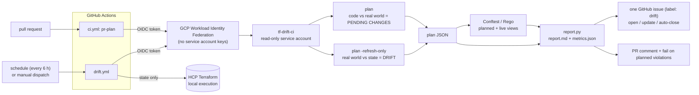

# tf-drift-detector

[](https://github.com/KulmeetSJ/tf-drift-detector/actions/workflows/ci.yml)
[](https://github.com/KulmeetSJ/tf-drift-detector/actions/workflows/drift.yml)

Scheduled Terraform **drift detection** plus **policy-as-code** for a GCP project, in GitHub Actions.
When someone changes the cloud by hand, a GitHub issue says exactly what changed. The issue closes itself once
the change is reverted or brought into code. The same Rego policies block risky changes in pull requests,
before they reach the cloud.

> Synthetic sandbox resources only. All numbers in [RESULTS.md](RESULTS.md) are personal-project benchmarks.

## How it works



**Drift vs. pending change.** A plain `terraform plan` mixes up two different things:
- *Drift*: someone changed the cloud, so the real world no longer matches state.
- *Pending change*: someone changed the code, but it hasn't been applied.

`plan -refresh-only` shows only drift. Running both plans, `report.py` labels every planned action as
**"reverts drift"** or **"code change not yet applied"**.

**Catching what Terraform doesn't manage.** Most project roles (e.g. `roles/editor`) aren't in the code, so a console
grant of one would never show up as drift. `infra/live_iam.tf` reads the *whole* live project IAM policy on every plan.
The report diffs it, and the policies check it.

**Authoritative resources on purpose.** `google_project_iam_binding` and dataset `access` blocks own their whole
member list. An extra member added by hand becomes visible drift; with `*_iam_member` it would be silently ignored.

## Policies (`policy/`, Conftest + Rego, 15 unit tests)
Each rule checks the **planned** state, so a PR is blocked before merge. It also checks the **live** state, which
catches console changes on the scheduled run.

| Rule | Example caught |
|---|---|
| No basic roles (`roles/editor`, `roles/viewer`; `roles/owner` only for humans) | console grant of `roles/editor` to a service account |
| Nothing public at project level | `allUsers` on any project role |
| No public or domain-wide dataset access | `allAuthenticatedUsers` READER on a dataset |
| Restricted data is readable only by workloads | a human READER on a `data-class=restricted` dataset |
| No service account keys | any `google_service_account_key` (WIF instead) |
| Required labels: `owner`, `env`, `cost-center`; `data-class` from an allowed list | dataset missing `cost-center` |

## Results
Personal-project benchmarks; details and raw data in [RESULTS.md](RESULTS.md).

| What | Result |
|---|---|
| Console-style changes detected (7 scenarios, incl. a grant on a role Terraform doesn't manage) | **7/7**, each naming the exact resource + attribute |
| Change → GitHub issue opened (manual dispatch; scheduled runs add up to 6 h) | **median 26 s** (23–28 s) |
| Change restored → issue closed automatically | **median 27 s** (22–28 s), 7/7 |
| False positives on a clean project | **0** (after the 4 fixes in [Lessons learned](#lessons-learned)) |
| Risky PR (dataset made public) | **blocked before merge** with the policy message ([PR #2](https://github.com/KulmeetSJ/tf-drift-detector/pull/2)) |
| Tests | 15 policy tests + 11 report tests, in CI |

## Layout
| Path | What |
|---|---|
| `bootstrap/` | One-time setup from a laptop: WIF pool and provider (restricted to this repo), read-only CI service account |
| `infra/` | The monitored stack: service accounts, authoritative IAM bindings, a custom role, BigQuery sandbox datasets |
| `policy/` | Rego policies and their unit tests (`conftest verify`) |
| `report/` | `report.py` and its unit tests, run on real (sanitized) plan fixtures |
| `scripts/induce_drift.sh` | 7 console-style changes (`list`, `<scenario>`, `all`, `revert`) |
| `scripts/measure_detection.sh` | Per scenario: induce → issue opened → restore → issue closed, timed |
| `.github/workflows/` | `drift.yml` (every 6 h + manual), `ci.yml` (tests on every push; plan + policy on PRs) |

## Run it yourself
Requires a GCP project (**no billing account needed**: IAM, WIF and the BigQuery sandbox are free), an HCP Terraform
organization (free), `gcloud`, `terraform` ≥ 1.10 and `conftest`.
```bash
export GOOGLE_OAUTH_ACCESS_TOKEN=$(gcloud auth print-access-token)
terraform -chdir=bootstrap init && terraform -chdir=bootstrap apply   # once
terraform -chdir=infra init && terraform -chdir=infra apply
scripts/plan_and_report.sh out && cat out/report.md                     # what CI does
scripts/induce_drift.sh all                                              # break things
scripts/induce_drift.sh revert && terraform -chdir=infra apply           # fix them
```
In the repo, set the `TF_API_TOKEN` secret and put your project number and service account in the workflows.

## Lessons learned
- **`-detailed-exitcode` is not a drift signal here.** With a data source in the config, `plan -refresh-only` exits `2`
  even when nothing changed. Drift is read from `resource_drift` and `output_changes` in the plan JSON instead.
- **Ignore attributes the provider recomputes.** Changing *any* project binding changes the IAM `etag` on every
  binding, so a naive diff reports false drift. `report.py` ignores `etag`, `last_modified_time` and the derived label maps.
- **Unset fields are `null` in planned values but `""` in state.** One policy treated `null != ""` as "domain-wide
  access", a false positive. It is now fixed and has a regression test.
- **API quota follows the credential.** With a `gcloud` user token, the provider billed quota to gcloud's shared client
  project, which returned HTTP 429. The provider retried silently, and a plan hung for 10 minutes.
  `user_project_override` + `billing_project` charge this project instead.
- **Applying `bootstrap/` changes project IAM.** The detector correctly reports that as drift in `infra/`. After an
  intentional bootstrap change, accept the new baseline with `terraform -chdir=infra apply -refresh-only`.

## Not covered (deliberately)
- Drift in resources that need billing (buckets, VPCs). The same approach applies; only the resource list changes.
- Auto-remediation. The CI identity is read-only on purpose: a human decides whether to revert the change or adopt it into code.
- Org-level IAM and org policies (personal project, no organization).

## License
MIT
